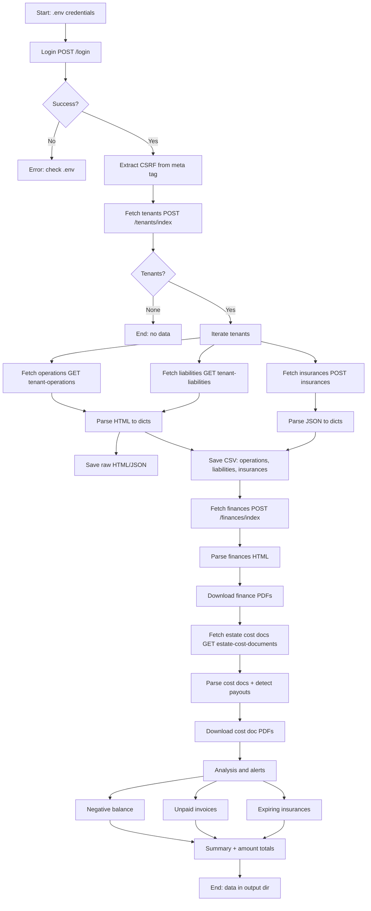
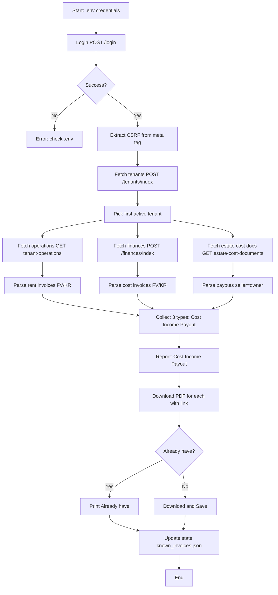

# SON Panel Automation Flow (your-panel.example.com)

## Script 1: `fetch_all_data.py` — full data fetch

### Flow diagram

### Steps

1. **Load credentials** from `.env` (SON_LOGIN, SON_PASSWORD, SON_PANEL_URL).
2. **Login**: POST `/login?backUrl=/` with form data. Extract CSRF from `<meta name="csrf-token">`.
3. **Fetch tenant list**: POST `/tenants/index` (paginated). Save to `tenants.json`.
4. **Per tenant:**
   - GET `/tenants/tenant-operations/{id}/` → parse operations table (Type, Date, Income, Expense, Balance, Document, Status, Description). Extract PDF links `/finances/download/{id}`.
   - GET `/tenants/tenant-liabilities/{id}/` → parse liabilities (item name, amounts, discounts, billing frequency, period).
   - POST `/tenants/insurances/{id}` → parse insurances (company, policy number, status, dates).
   - Save raw responses (ops_{id}.html, liab_{id}.html, ins_{id}.json).
   - Download invoice PDFs to `pdfs_{id}/`.
5. **Save CSV**: operations.csv, liabilities.csv, insurances.csv (UTF-8 with BOM for Excel).
6. **Fetch owner finances**: POST `/finances/index` with `length=100` → parse (Type, Date, Payment, Charge, Balance, Document, Status, Description). Download PDFs to `finances_pdfs/`. Save `finances.csv`.
7. **Fetch estate cost documents**: GET `/estates/estate-cost-documents/{id}/` → parse (Date added, Sale date, Seller, Number, Amount, Deadline, Payment date). Detect payouts (seller = owner). Download PDFs via two-step (zip → redirect → download-file) to `cost_docs_pdfs/`. Save `cost_documents.csv`.
8. **Alerts**: negative balance, unpaid invoices, insurances expiring within 60 days.
9. **Summary**: print counts, alerts, amount totals (income, costs, payouts, balance). Data saved to output directory.

### What it does NOT do
- Does not fetch tickets, documents, meters, or reports.
- Does not send notifications (console output only; notification channels require configuration).

---

## Script 2: `fetch_latest_invoice.py` — fetch latest invoice (LATEST mode)

### Flow

1. **Load credentials** from `.env`.
2. **Login** (same as above).
3. **Fetch tenant list** — pick first active tenant.
4. **Fetch from 3 sources:**
   - Tenant operations (rent invoices) → FV/KR with PDF links
   - Owner finances (cost invoices) → FV/KR with PDF links
   - Estate cost documents (payouts where seller is owner) → entries with amount
5. **Find latest of each type:**
   - Last cost invoice (latest FV/KR with PDF)
   - Last income entry (latest payment/settlement)
   - Last payout (latest estate cost document where seller is owner)
6. **Report all three** (Cost, Income, Payout).
7. **Download PDF** for each entry that has a PDF link.
8. **Check state**: if already downloaded → "Already have", if new → "Saved".
9. **Update state** (known_invoices.json).

### What it does NOT do
- Does not fetch liabilities, insurances, or other data.
- Does not generate CSV or alerts.
- Does not fetch all entries (only latest of each type).

---

## Shared library: `lib/son_client.py`

Both scripts use `SONInternalClient` from `lib/son_client.py`:

| Method | Endpoint | Returns |
|--------|----------|---------|
| `get_tenants()` | POST /tenants/index | List of tenant dicts |
| `get_estates()` | POST /estates/index | List of estate dicts |
| `get_tenant_operations(id)` | GET /tenants/tenant-operations/{id}/ | HTML string |
| `get_tenant_liabilities(id)` | GET /tenants/tenant-liabilities/{id}/ | HTML string |
| `get_insurances(id)` | POST /tenants/insurances/{id} | JSON (dict) |
| `get_finances(page_size)` | POST /finances/index | HTML string |
| `get_estate_cost_documents(id)` | GET /estates/estate-cost-documents/{id}/ | HTML string |
| `get_cost_document_download_url(id)` | GET /download-files-zip/?object=costDocument&object_id={id} | Download URL (redirect) |
| `parse_operations(html, id, name)` | — | List of operation dicts |
| `parse_liabilities(html, id, name)` | — | List of liability dicts |
| `parse_insurances(data, id, name)` | — | List of insurance dicts |
| `parse_finances(html)` | — | List of finance dicts |
| `parse_estate_cost_documents(html, owner_name)` | — | List of cost document dicts |

| `download_file(url, path)` | GET (any) | True/False |
| `fetch_invoice_pdfs(ops, id, dir)` | /finances/download/{id} | List of downloaded paths |
| `normalize_url(url)` | — | Absolute URL |

## Key facts

- **CSRF token**: `<meta name="csrf-token" content="...">` in `<head>` — no hidden input, no JS variable.
- **Timestamp `?_=`**: optional (jQuery cache-buster).
- **Accept header**: does not affect response format.
- **JSON vs HTML**: determined by endpoint, not by headers.
- **PDF download (finances)**: `/finances/download/{finance_id}` → `application/pdf`.
- **PDF download (cost documents)**: two-step: `/download-files-zip/?object=costDocument&object_id={id}` → JSON redirect → `/download-file/?object=costDocument&object_id={id}&file_id={file_id}` → `application/pdf`.
- **Tenant file download**: `/download-file/?object=user&object_id={id}&file_id={file_id}` → file.
- **Session**: cookie `SON_SESSID`, expires after inactivity.
- **Rate limiting**: unofficial, use 1 req/s.
- **Payouts**: tracked in estate cost documents where seller = owner name. Not in finances table.
